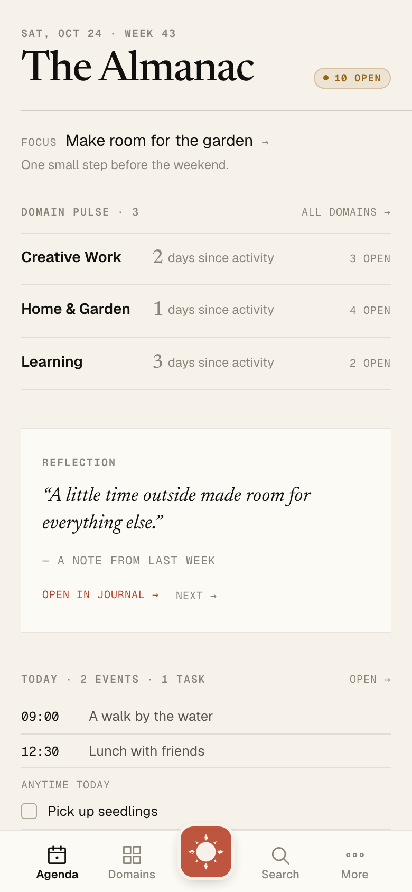
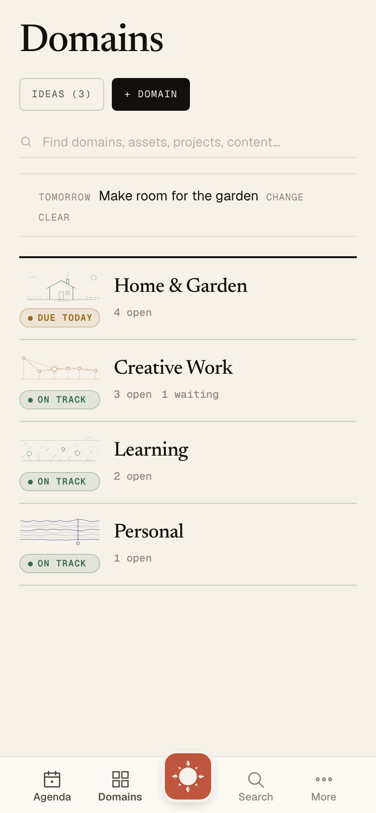
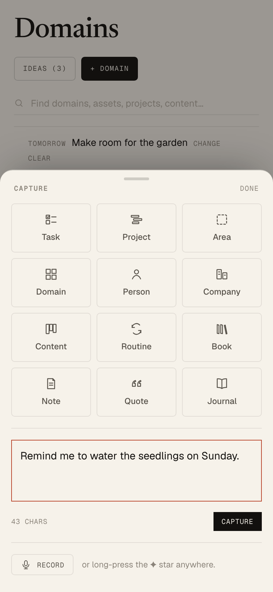

# jevi-ops

**Your day, in context.**

jevi-ops is a self-hosted personal operations system for work, home and the things you want to remember. Its interface, **Almanac**, brings voice and text capture, projects, people, notes and everyday responsibilities into one place—so you can see what needs attention without keeping it all in your head.

A responsive web app and native iOS companion connect to a **Docker-containerized service** on your own hardware. Your server holds the record; you choose the language model, transcription service and integrations around it.

## Why jevi-ops

- **Capture while it's fresh.** Speak or type a thought, save a note, or create a task from one capture surface. Shortcuts and agents can send captures to the same system.
- **See the day in context.** An adjustable daily agenda brings together your focus, calendar, tasks, routines and a passage from your library.
- **Keep responsibilities connected.** Organize projects, content and tasks into domains. Keep people, household assets and maintenance records alongside the work they relate to.
- **Return to what matters.** Keep journals, notes, books and quotations in a searchable library, with selected entries resurfacing in the daily briefing.
- **Keep going away from your server.** The iOS companion saves captures on the phone and queues supported task edits for later sync. Its latest synced workspace remains available offline.
- **Run it on your terms.** Host the application and PostgreSQL database yourself, reach them through Tailscale, and configure your own AI services. Calendar, photo and notification integrations are optional.

## Screenshots

The current web interface in **Almanac's** visual language: linen backgrounds, readable type, quiet status indicators and a central capture control. These screenshots use fictional sample data.

<!-- Captured 2026-10-24 from the web UI at 3c8a2610 with a local sample-data API; 390 × 844 viewport, 2× scale. -->
<table>
  <tr>
    <td align="center"> See the day in context</td>
    <td align="center"> Find where things belong</td>
    <td align="center"> Capture in the moment</td>
  </tr>
</table>

## The long-term vision

**A quieter Life OS.** The goal is a system you can speak freely into: wishes, questions, worries and unfinished thoughts can be worth keeping without becoming obligations. Practical help should arrive when you ask for it or when the context makes it useful.

**A lasting record across surfaces.** The server holds the shared memory while phones, browsers, shortcuts and agents provide ways to capture and return to it. Saving a thought, interpreting it and acting on it are distinct steps.

This proposed direction extends the existing dashboard; the full Life OS experience is still ahead.

## Where we're headed

**Now:** refine the web and native iOS experience, strengthen capture and offline sync, and keep the daily interface useful as the underlying record grows.

**Next:** build toward the Life OS direction—preserving original expression, connecting related thoughts over time and offering small, reviewable next steps when wanted.

## Project status

jevi-ops is an actively developed, single-user application with a working web app, API and native iOS companion. Offline support covers specific native workflows; it does not extend to every screen or integration. The [iOS guide](apps/ios/README.md) and [offline behavior notes](apps/ios/offline.md) describe the current boundaries.

The project began as a self-hosted fork of [jerad-ops](https://github.com/3SecondsAgo/jerad-ops). It uses Next.js and React for the web, SwiftUI for iOS, Fastify for the API, and PostgreSQL with Drizzle for storage.

## Get started

- [Local development](docs/development.md) — prerequisites, first-run setup, everyday commands and architecture.
- [Self-host with Docker](infrastructure/docker/README.md) — deployment on TrueNAS SCALE or another Docker host.
- [Configure integrations](infrastructure/DEPENDENCIES.md) — Tailscale, AI, transcription, Immich, Calendar and notifications.
- [Run the iOS companion](apps/ios/README.md) — build, link your server and use the synced workspace.
- [Capture from Hermes](workers/hermes-capture/README.md) — save text from the desktop agent with a storage receipt.
- [Migrate from Supabase](infrastructure/MIGRATION.md) — move an existing hosted deployment to your own server.
